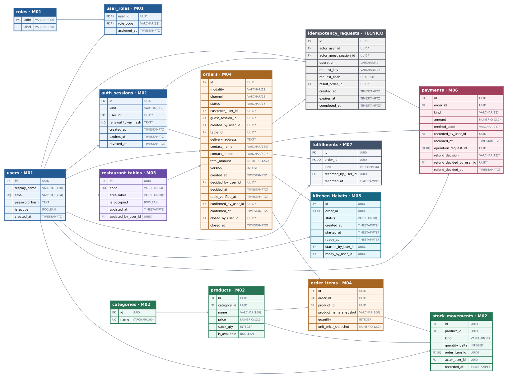

# ETAPA 06 — Diseño de base de datos | Chifa ASIA

**Estado:** APROBADA POR EL USUARIO (2026-10-21) · Diseño documental  
**Proyecto:** Restaurant App V2 · **Base prevista:** PostgreSQL · **Rama de referencia:** `develop`  
**Fuentes:** [ETAPA 01](etapa-01.md), [ETAPA 02](etapa-02.md), [ETAPA 03 — RN/RNF](etapa-03.md), [ETAPA 03 — 40 RF/48 CA](etapa-03-requisitos.md), [ETAPA 04](etapa-04.md), [ETAPA 05](etapa-05.md) y `AGENTS.md`.

**Naturaleza del entregable:** propuesta de **modelo conceptual, lógico y físico**, sin SQL ejecutado, tablas creadas, migraciones, modelos ORM ni implementación. Las denominaciones de columnas, códigos de estado y mecanismos de persistencia de este documento son **propuestas técnicas de ETAPA 06**, no decisiones de negocio ratificadas por su mera inclusión.

## 1. Modelo conceptual y límites

Un único restaurante, **siete módulos funcionales M01–M07**, seis actores, tres modalidades (`LOCAL`, `PICKUP`, `DELIVERY`) y cuatro canales (`APP`, `WAITER`, `PHONE`, `WHATSAPP`); la llamada y WhatsApp se registran manualmente. El invitado es una **sesión**, nunca un séptimo rol.

| Propietario | Entidades conceptuales | Relaciones relevantes |
|---|---|---|
| **M01 — Accesos** | Usuario, Rol, Asignación de rol, Sesión | Usuario 1:N Sesión; Usuario N:M Rol; Sesión de invitado sin usuario registrado |
| **M02 — Catálogo/stock** | Categoría, Producto, Movimiento de stock | Categoría 1:N Producto; Producto 1:N Movimiento; movimiento por línea confirmada opcionalmente |
| **M03 — Mesas** | Mesa | Mesa 1:N Pedido local a lo largo del tiempo |
| **M04 — Pedidos** | Pedido, Línea de pedido | Pedido 1:N Línea; Línea N:1 Producto; pedido de app asociado a usuario **o** sesión invitada |
| **M05 — Cocina** | Comanda | Pedido confirmado 1:0..1 Comanda; detalle visible desde líneas del pedido, sin copiarlo |
| **M06 — Caja/pagos** | Pago simulado, incluidas verificaciones de anticipo | Pedido 1:N Pago; máximo un anticipo **registrado** por pedido |
| **M07 — Atención/entrega** | Registro de atención o entrega | Pedido 1:0..1 Registro de servicio/recojo/delivery |
| **Técnico compartido** | Operación idempotente | Principal 1:N solicitudes críticas; la operación referencia el pedido resultante cuando aplica |

**Decisiones de modelado:** 14 tablas propuestas, dentro del esquema PostgreSQL `public` (sin un esquema independiente por módulo). Cada módulo conserva propiedad lógica de sus datos. Se proponen referencias FK entre módulos para integridad relacional; en código los módulos siguen comunicándose por puertos públicos, sin acceder a repositorios ajenos. El total comercial conserva precios por línea al momento de la solicitud. El estado global mostrado al cliente es **compuesto**: comercial (M04) + cocina (M05) + pagos (M06) + atención/entrega (M07), sin duplicar cuatro estados en `orders`.

### 1.1 Diagrama entidad-relación (DER) editable

- **[Abrir DER editable en diagrams.net](diagramas/etapa-06/etapa-06-der.drawio)**: archivo fuente con las **14 tablas**, sus claves y relaciones; editable directamente en [app.diagrams.net](https://app.diagrams.net/) mediante **Archivo → Abrir desde → Dispositivo**.
- **[Vista previa vectorial del DER](diagramas/etapa-06/etapa-06-der.svg)**: imagen escalable para inspección sin modificar el modelo.

**Lectura:** los vínculos muestran FKs y cardinalidades conceptuales; una misma entidad puede tener varias FKs al usuario, agrupadas visualmente para evitar conexiones redundantes. La nulabilidad exacta, los índices únicos parciales y las condiciones que abarcan varias tablas prevalecen según el diccionario de datos y las secciones 3–4 de este documento. **No es un esquema SQL ejecutable.**

## 2. Modelo lógico y diccionario de datos

**Notación:** `PK` primaria, `FK` foránea, `UQ` única, `NN` no nulo; el resto es nullable. `UUID` se propone como identificador y `TIMESTAMPTZ` como fecha/hora de auditoría. Los campos enumerados con `VARCHAR` + `CHECK` son códigos técnicos propuestos (no nuevas funcionalidades). Los campos `*_by` guardan usuarios existentes, no roles inventados.

### M01 — Usuarios y accesos

**2.1 `users`** — Cuenta registrada de cliente o miembro del personal. **RF-M01-01, 03–05**.

| Columna | Tipo | Regla |
|---|---|---|
| `id` | UUID | PK |
| `display_name` | VARCHAR(120) | NN |
| `email` | VARCHAR(254) | NN; único sin distinguir mayúsculas/minúsculas mediante índice funcional |
| `password_hash` | TEXT | NN; Argon2 adaptativo, nunca contraseña en claro |
| `is_active` | BOOLEAN | NN, `DEFAULT TRUE` |
| `created_at` | TIMESTAMPTZ | NN |

**2.2 `roles`** — Catálogo restringido a seis códigos aprobados. **RF-M01-03–05**.

| Columna | Tipo | Regla |
|---|---|---|
| `code` | VARCHAR(32) | PK; códigos de referencia `CUSTOMER`, `WAITER`, `CASHIER`, `ADMIN`, `KITCHEN`, `SUPER_ADMIN` |
| `label` | VARCHAR(80) | NN |

**2.3 `user_roles`** — Relación N:M, roles acumulativos. **RF-M01-03–05**.

| Columna | Tipo | Regla |
|---|---|---|
| `user_id` | UUID | PK compuesta; FK → `users.id`; NN |
| `role_code` | VARCHAR(32) | PK compuesta; FK → `roles.code`; NN |
| `assigned_at` | TIMESTAMPTZ | NN |

Los permisos efectivos los aplica el backend por unión de roles; `SUPER_ADMIN` accede a todas las operaciones. No se crea una tabla genérica de permisos sin RF que exija administrarlos individualmente.

**2.4 `auth_sessions`** — Sesión de usuario o invitado, válida/revocable. **RF-M01-01–02, RNF-02/10**.

| Columna | Tipo | Regla |
|---|---|---|
| `id` | UUID | PK |
| `kind` | VARCHAR(12) | NN; `USER` o `GUEST` |
| `user_id` | UUID | FK → `users.id`; obligatorio solo en `USER` |
| `renewal_token_hash` | TEXT | Nullable; secreto de renovación hasheado, nunca token en claro; UQ cuando no sea NULL |
| `created_at`, `expires_at` | TIMESTAMPTZ | NN |
| `revoked_at` | TIMESTAMPTZ | Nullable |

`CHECK`: (`kind='USER'` ↔ `user_id IS NOT NULL`); `expires_at > created_at`. Sesiones revocadas o caducadas no autorizan operaciones nuevas. Un pedido histórico conserva su referencia a la sesión invitada aunque esta expire; evitar borrado físico de sesiones referenciadas.

### M02 — Catálogo, precios y existencias

**2.5 `categories`** — Categorías del catálogo. **RF-M02-01–02**.

| Columna | Tipo | Regla |
|---|---|---|
| `id` | UUID | PK |
| `name` | VARCHAR(100) | NN; UQ (decisión técnica propuesta) |

**2.6 `products`** — Catálogo y stock actual del producto terminado, no de ingredientes. **RF-M02-01–06**.

| Columna | Tipo | Regla |
|---|---|---|
| `id` | UUID | PK |
| `category_id` | UUID | NN; FK → `categories.id` |
| `name` | VARCHAR(160) | NN |
| `price` | NUMERIC(12,2) | NN; `CHECK (price >= 0)` |
| `stock_qty` | INTEGER | NN, `DEFAULT 0`; `CHECK (stock_qty >= 0)` (exigencia técnica de RNF-04; RN-20 sigue formalmente pendiente) |
| `is_available` | BOOLEAN | NN, `DEFAULT TRUE` |

`is_available` es el bloqueo comercial manual; **no** se infiere automáticamente de `stock_qty`. Nunca se cambia `stock_qty` sin registrar el movimiento correspondiente en la misma transacción. No se propone inventario de ingredientes.

**2.7 `stock_movements`** — Auditoría de ajustes administrativos y descuentos de confirmación. **RF-M02-03, 05–06; RNF-04/09**.

| Columna | Tipo | Regla |
|---|---|---|
| `id` | UUID | PK |
| `product_id` | UUID | NN; FK → `products.id` |
| `kind` | VARCHAR(12) | NN; `MANUAL` o `ORDER` |
| `quantity_delta` | INTEGER | NN, distinto de cero; en `ORDER` estrictamente negativo |
| `order_item_id` | UUID | FK → `order_items.id`; NN solo para `ORDER`; NULL para `MANUAL` |
| `actor_user_id` | UUID | FK → `users.id`; NN; empleado que ajusta o autoriza la confirmación |
| `recorded_at` | TIMESTAMPTZ | NN |

Índice único parcial `UQ(order_item_id) WHERE kind='ORDER'`: impide repetir el descuento de la misma línea confirmada. Validar por caso de uso que `stock_movements.product_id = order_items.product_id`. La actualización del saldo `products.stock_qty` y el movimiento ocurren juntos. Ajuste manual: `quantity_delta = nueva_cantidad − anterior`, sin registrar un segundo stock de verdad.

### M03 — Gestión de mesas

**2.8 `restaurant_tables`** — Distribución y ocupación del **único** restaurante. **RF-M03-01–04**.

| Columna | Tipo | Regla |
|---|---|---|
| `id` | UUID | PK |
| `code` | VARCHAR(24) | NN, UQ; identificador visible de mesa |
| `area_label` | VARCHAR(80) | Nullable; zona descriptiva de la distribución |
| `is_occupied` | BOOLEAN | NN, `DEFAULT FALSE` |
| `updated_at` | TIMESTAMPTZ | NN |
| `updated_by_user_id` | UUID | FK → `users.id`; nullable para creación inicial |

La **ocupación** refleja una operación de personal autorizado; elegir una mesa en la app no demuestra su ocupación real ni la aprobación presencial. La liberación de mesa y sus permisos se rigen por los RF/decisiones aprobadas; no se inventa automatismo de liberación al cerrar pedidos.

### M04 — Solicitudes, aprobaciones y pedidos

**2.9 `orders`** — Cabecera, canal, modalidad, snapshot del importe y metadatos de aprobación/confirmación/cierre. **RF-M04-01–11**.

| Columna | Tipo | Regla |
|---|---|---|
| `id` | UUID | PK |
| `modality` | VARCHAR(12) | NN; `LOCAL`, `PICKUP`, `DELIVERY` |
| `channel` | VARCHAR(12) | NN; `APP`, `WAITER`, `PHONE`, `WHATSAPP` |
| `status` | VARCHAR(16) | NN; propuesta: `REQUESTED`, `APPROVED`, `REJECTED`, `CONFIRMED`, `CANCELLED`, `CLOSED` |
| `customer_user_id` | UUID | FK → `users.id`; nullable |
| `guest_session_id` | UUID | FK → `auth_sessions.id`; nullable |
| `created_by_user_id` | UUID | FK → `users.id`; nullable para solicitudes en app |
| `table_id` | UUID | FK → `restaurant_tables.id`; NN solo en local |
| `delivery_address` | TEXT | NN solo en delivery |
| `contact_name` | VARCHAR(120) | Nullable; contacto necesario cuando aplique |
| `contact_phone` | VARCHAR(30) | Nullable; contacto necesario cuando aplique |
| `total_amount` | NUMERIC(12,2) | NN; total comercial de líneas, `CHECK (total_amount > 0)`; no se registran pedidos de importe cero |
| `version` | INTEGER | NN, `DEFAULT 0`, `CHECK (version >= 0)` |
| `created_at` | TIMESTAMPTZ | NN |
| `decided_by_user_id`, `decided_at` | UUID FK → `users.id`; TIMESTAMPTZ | Nullable; aprobación o rechazo de una solicitud |
| `table_verified_at` | TIMESTAMPTZ | Nullable; evidencia temporal de verificación presencial antes de aprobar app local |
| `confirmed_by_user_id`, `confirmed_at` | UUID FK → `users.id`; TIMESTAMPTZ | Nullable; autor de confirmación y momento; conservar rastreo de autorización |
| `closed_by_user_id`, `closed_at` | UUID FK → `users.id`; TIMESTAMPTZ | Nullable; M07 solicita cierre, **M04** cambia estado comercial |

**Restricciones estructurales:**

- `modality='LOCAL'` ⇒ `table_id IS NOT NULL` y `delivery_address IS NULL`; `DELIVERY` ⇒ `table_id IS NULL` y dirección no vacía; `PICKUP` ⇒ sin mesa ni dirección de delivery. Las validaciones de contenido de contacto se realizan por modalidad en backend.
- `channel='WAITER'` ⇒ local; `PHONE`/`WHATSAPP` ⇒ recojo o delivery; `APP` permite las tres modalidades.
- `APP` ⇒ exactamente **uno** entre `customer_user_id` y `guest_session_id` (para invitado, la sesión referida debe ser `GUEST`: validación de aplicación); pedido registrado por personal ⇒ `created_by_user_id` obligatorio. La autorización por rol requiere consulta al servidor, no es un `CHECK` entre tablas.
- `decided_by_user_id` y `decided_at` se registran como par; `confirmed_at` y `closed_at` se asignan una sola vez a sus transiciones respectivas. No se infiere que un pedido por mozo requiera una decisión adicional.
- Los códigos de estado son **propuesta técnica**: validar la máquina de estados concreta contra RF/CU antes de migrar; `CANCELLED` permite registrar la decisión de devolución administrativa sin implementar reembolso automático.

**2.10 `order_items`** — Snapshot comercial de cada producto en el pedido. **RF-M04-02, 05, 11; M02-06; M05-02**.

| Columna | Tipo | Regla |
|---|---|---|
| `id` | UUID | PK |
| `order_id` | UUID | NN; FK → `orders.id` |
| `product_id` | UUID | NN; FK → `products.id` |
| `product_name_snapshot` | VARCHAR(160) | NN; nombre histórico, no sustituye catálogo |
| `quantity` | INTEGER | NN; `CHECK (quantity > 0)` |
| `unit_price_snapshot` | NUMERIC(12,2) | NN; `CHECK (unit_price_snapshot >= 0)` |

`UQ(order_id,product_id)` consolida repeticiones del mismo producto en una línea. `total_amount` se calcula como `SUM(quantity × unit_price_snapshot)` y se fija consistentemente con las líneas en una sola transacción; los importes/instantáneas son **duplicaciones históricas justificadas**, no precios vivos. No se mantienen subtotales derivables por línea. **Regla de inmutabilidad:** desde el registro de la solicitud, las líneas, cantidades, precios históricos y total quedan congelados; los 40 RF no contemplan edición posterior de un pedido. Por tanto, nunca se modifica el total después de verificar el anticipo. El backend bloqueará escrituras sobre estos campos; los `CHECK` no pueden hacer cumplir esta invariante entre tablas.

### M05 — Cocina y comandas

**2.11 `kitchen_tickets`** — Única comanda de cada pedido confirmado. **RF-M05-01–04**.

| Columna | Tipo | Regla |
|---|---|---|
| `id` | UUID | PK |
| `order_id` | UUID | NN, UQ; FK → `orders.id` |
| `status` | VARCHAR(20) | NN; `RECEIVED`, `PREPARING`, `READY` |
| `created_at` | TIMESTAMPTZ | NN |
| `started_at`, `ready_at` | TIMESTAMPTZ | Nullable |
| `started_by_user_id`, `ready_by_user_id` | UUID | FK → `users.id`, nullable según transición |

El detalle y las cantidades de la comanda **se leen de `order_items`**, no se duplican en una tabla de cocina. Crear comanda y confirmar pedido deben formar parte del **mismo commit**. Solo cocina autorizada puede iniciar preparación o marcar `READY`. **Decisión:** el personal de Cocina confirma manual y expresamente que **todos** los productos del pedido terminaron de prepararse; `ready_by_user_id` y `ready_at` dejan constancia de quién lo declaró y cuándo. No se afirma una verificación automática por producto, porque no se ha aprobado seguimiento unitario. El estado comercial no se modifica desde el repositorio de cocina.

### M06 — Caja, anticipo y devoluciones decididas manualmente

**2.12 `payments`** — Cada cobro o anticipo **simulado ya confirmado**, que afecta el saldo. **RF-M06-01–06, RN-12/13/17/19, RNF-05/09**.

| Columna | Tipo | Regla |
|---|---|---|
| `id` | UUID | PK |
| `order_id` | UUID | NN; FK → `orders.id` |
| `kind` | VARCHAR(12) | NN; `ADVANCE` o `COLLECTION` |
| `amount` | NUMERIC(12,2) | NN; `CHECK (amount > 0)` |
| `method_code` | VARCHAR(24) | Nullable; método simulado, catálogo definitivo aún no fijado en RF |
| `recorded_by_user_id` | UUID | NN; FK → `users.id` |
| `recorded_at` | TIMESTAMPTZ | NN |
| `operation_request_id` | UUID | NN, UQ; FK → `idempotency_requests.id` |
| `refund_decision` | VARCHAR(12) | Nullable; `APPROVED` o `DENIED`, **solo** para anticipo |
| `refund_decided_by_user_id` | UUID | FK → `users.id`; nullable |
| `refund_decided_at` | TIMESTAMPTZ | Nullable |

**Índice único parcial:** `UNIQUE(order_id) WHERE kind='ADVANCE'`, para un anticipo **registrado** por pedido. La verificación administrativa genera **exactamente un `payments` de tipo `ADVANCE`**; la confirmación del pedido **solo consulta** ese abono. `COLLECTION` admite varios registros; cada operación lleva llave de idempotencia. **Saldo derivado** = `orders.total_amount − SUM(payments.amount)` (no guardar saldo redundante), con comprobación transaccional de que no resulte negativo. **Regla monetaria aprobada por el usuario:** el anticipo obligatorio es `CEIL(total_amount × 50) / 100`, donde `total_amount` es un decimal PEN con dos posiciones; equivale a **50 % redondeado al céntimo superior**. El restante inicial es `total_amount − anticipo` (no otro 50 % redondeado). Ejemplos: S/ 80.00 → anticipo S/ 40.00, restante S/ 40.00; S/ 10.01 → anticipo S/ 5.01, restante S/ 5.00; S/ 0.01 → anticipo S/ 0.01, restante S/ 0.00. Posteriores cobros reducen `saldo = total_amount − SUM(payments.amount)` sin permitir saldo negativo. Si el redondeo hace que el saldo inicial sea S/ 0.00 (p. ej. pedido de S/ 0.01), no se crea un cobro adicional de importe cero. **Total cero:** se rechaza la solicitud al registrarla, para cualquier modalidad, porque los RF no prevén pedidos gratuitos ni pagos de importe cero; la base de datos refuerza esta decisión con `CHECK (total_amount > 0)`. Sin anticipo confirmado no hay comanda para recojo/delivery. No se realiza ni registra un reembolso automático: `refund_decision` solo consigna **una decisión**, no un reembolso ejecutado, y no elimina el pago histórico. **Los campos financieros** (`kind`, `amount`, `method_code`, `operation_request_id`, `order_id`, autor y fecha del pago) **son inmutables tras registrar el cobro**; como única excepción, el bloque `refund_decision`/`refund_decided_by_user_id`/`refund_decided_at` pasa **una sola vez** de NULL a la decisión del Administrador, con autor y fecha, sin modificaciones posteriores. Esto no altera el saldo contabilizado ni declara una devolución realizada; no se introduce tabla ni automatización de reembolsos. Exigir en backend que un permiso de verificación de anticipo no otorgue permisos generales de Caja.

**`CHECK`:** `refund_decision`/`refund_decided_by_user_id`/`refund_decided_at` nulos conjuntamente o completos conjuntamente; los tres deben ser NULL si `kind='COLLECTION'`. La cancelación del pedido y el rol del decisor se comprueban en el caso de uso.

### M07 — Atención, recojo, entrega y cierre

**2.13 `fulfillments`** — Registro único de que la modalidad fue atendida. **RF-M07-01–04, RN-17/18**.

| Columna | Tipo | Regla |
|---|---|---|
| `id` | UUID | PK |
| `order_id` | UUID | NN, UQ; FK → `orders.id` |
| `kind` | VARCHAR(16) | NN; `SERVED`, `PICKED_UP`, `DELIVERED` |
| `recorded_by_user_id` | UUID | NN; FK → `users.id` |
| `recorded_at` | TIMESTAMPTZ | NN |

`LOCAL` ↔ `SERVED`; `PICKUP` ↔ `PICKED_UP`; `DELIVERY` ↔ `DELIVERED` (validación de caso de uso). El registro **no** incluye repartidores, rutas ni GPS. M07 comprueba que cocina figure como `READY` cuando corresponda y solicita cierre a M04. La autorización para registrar recojo, delivery y cierre **no se asigna** en este modelo: depende de ratificación pendiente de M07. El backend impedirá el cierre sin servicio/entrega y pago total según los RF-M06-06 y RF-M07-04, aunque RN-21 no esté ratificada formalmente.

### Infraestructura técnica mínima — Idempotencia

**2.14 `idempotency_requests`** — Identifica operaciones críticas reintentadas; soporte de RNF-04/05/10 y arquitectura ETAPA 05, no módulo funcional nuevo.

| Columna | Tipo | Regla |
|---|---|---|
| `id` | UUID | PK |
| `actor_user_id` | UUID | FK → `users.id`; nullable |
| `actor_guest_session_id` | UUID | FK → `auth_sessions.id`; nullable |
| `operation` | VARCHAR(40) | NN; código de operación (crear/confirmar pedido, cobro, etc.) |
| `request_key` | VARCHAR(128) | NN; llave suministrada por el cliente, no token secreto |
| `request_hash` | CHAR(64) | NN; huella del payload para detectar reuso indebido |
| `result_order_id` | UUID | FK → `orders.id`; nullable hasta producir resultado |
| `created_at`, `expires_at` | TIMESTAMPTZ | NN |
| `completed_at` | TIMESTAMPTZ | Nullable |

`CHECK`: exactamente uno entre `actor_user_id` y `actor_guest_session_id`; `expires_at > created_at`. **Dos índices únicos parciales** sobre `(actor_user_id,operation,request_key)` y `(actor_guest_session_id,operation,request_key)` según el actor no nulo, porque un `UNIQUE` común con nulos no protege ambos casos. Las escrituras de negocio y la marca de éxito de la operación se confirman en la misma transacción; al reintentar con la misma llave y hash se recupera el resultado en vez de repetir efectos. La retención y expiración de las llaves requieren una política de seguridad a concretar en ETAPA 07, sin borrar datos necesarios para la deduplicación de operaciones históricas.

## 3. Modelo físico PostgreSQL: claves, índices y normalización

**Tipos recomendados:** UUID, `VARCHAR(n)` para códigos, `TEXT` para descripciones libres, `INTEGER` para unidades de producto, `NUMERIC(12,2)` para dinero, `BOOLEAN`, `TIMESTAMPTZ` para auditoría. Evitar `FLOAT` para dinero, tokens en claro, eliminación física en cascada de pedidos/pagos, y ENUM nativos de PostgreSQL mientras no estén ratificadas las transiciones. Todos los FK de eventos históricos llevan `ON DELETE RESTRICT/NO ACTION` (sin borrado cascada); se conserva trazabilidad de usuarios y sesiones referenciados. Generar UUID y fechas desde el backend o valores por defecto en PostgreSQL en ETAPA 07, una sola estrategia consistente.

| Tabla | Clave(s) de acceso adicionales justificadas | Motivo |
|---|---|---|
| `users` | `UNIQUE INDEX lower(email)` | Login insensible a mayúsculas/minúsculas |
| `user_roles` | `(role_code,user_id)` | Consultar miembros de un rol |
| `auth_sessions` | `UNIQUE(renewal_token_hash)` (cuando exista); `(user_id,expires_at)` | Renovación/revocación |
| `products` | `(category_id,is_available)` | Catálogo por categoría |
| `stock_movements` | `UNIQUE(order_item_id) WHERE kind='ORDER'`; `(product_id,recorded_at DESC)` | No doble descuento; auditoría |
| `orders` | `(customer_user_id,created_at DESC)` y `(guest_session_id,created_at DESC)` parciales; `(status,created_at DESC)` | Seguimiento por propietario y cola de revisión |
| `order_items` | `UNIQUE(order_id,product_id)`; `(product_id)` | Línea única por producto; integridad FK |
| `kitchen_tickets` | `UNIQUE(order_id)`; `(status,created_at)` | Comanda única y cola de cocina |
| `payments` | `UNIQUE(operation_request_id)`; `UNIQUE(order_id) WHERE kind='ADVANCE'`; `(order_id,recorded_at)` | Idempotencia de cobros, anticipo único, saldo |
| `fulfillments` | `UNIQUE(order_id)` | Una atención/entrega registrada por pedido |
| `idempotency_requests` | Dos `UNIQUE` parciales por tipo de actor; `(expires_at)` | Deduplicación y limpieza controlada |

Los FK que ya disponen de índice único o PK no necesitan un índice duplicado. Un índice extra solo se justifica con consultas verificadas durante la ETAPA 08. **Normalización:** las relaciones N:M residen en `user_roles`; no hay listas de productos, roles o pagos dentro de columnas de texto/JSON; el saldo se **deriva** de pagos; estados de cocina/entrega no se duplican en `orders`. Las excepciones deliberadas son `order_items.product_name_snapshot`, `order_items.unit_price_snapshot`, `orders.total_amount` (importe comercial histórico) y `products.stock_qty` (saldo actual para operación atómica) reconciliable con movimientos. Estas excepciones evitan alterar ventas históricas y sostienen operaciones transaccionales; deben verificarse en pruebas.

## 4. Integridad transaccional, concurrencia e idempotencia

| Operación | Regla exigida | Garantía PostgreSQL | Validación backend / UoW |
|---|---|---|---|
| Registrar pedido | Sin doble creación por reintento | UQ idempotencia por actor+operación+clave; insertar cabecera y líneas juntas | Validar modalidad/canal, usuario/invitado, mesa/dirección, productos y total |
| Aprobar/rechazar | Actor y fecha; nunca avanzar rechazados | FK al usuario, columna de estado y versión | Comprobar rol y canal: local app Mozo/Administrador con mesa verificada; recojo/delivery app Administrador; personal autorizado no requiere segunda aprobación |
| Ajustar stock | Registro exacto del cambio | Actualizar saldo y crear movimiento en misma transacción; `CHECK(stock_qty>=0)` | Permiso Administrador, cantidad válida y motivo de operación; validar diferencia del ajuste |
| Confirmar pedido | **Todo o nada**: estado, stock y comanda | Una transacción PostgreSQL, bloqueo de pedido/productos, descuentos condicionales, UQ por línea y UQ comanda | M04 coordina M02, M06 y M05; confirmar solo aprobado o personal autorizado; anticipo ya verificado para recojo/delivery; reintentos devuelven resultado sin nuevos efectos |
| Verificar anticipo | Un solo abono simulado del 50 % | UQ parcial por pedido; pago y deduplicación en mismo commit | Solo Administrador/Superadministrador (o roles acumulados pertinentes), comparar importe con total; no registrar otro pago al confirmar |
| Registrar cobro | Cobros parciales sin doble conteo ni saldo negativo | UQ `operation_request_id`, pagos inmutables; bloqueo de pedido para sumar | Cajero/Superadministrador (o cuenta con rol Cajero), verificar saldo actual y momento de cobro conforme a modalidad |
| Preparar cocina | Solo pedido confirmado, comanda única | FK+UQ comanda; transición y autor/fecha persistidos | Solo Cocina con permiso; READY después de completar todos los productos del pedido |
| Entregar / cerrar | Registrar atención y cerrar una sola vez, respetando saldo | UQ de entrega, actualización comercial en transacción | M07 solicita y M04 cierra; no cerrar con saldo > 0 ni sin servicio/entrega; responsables M07 pendientes |

**Propuesta precisa de `ConfirmOrder`:** abrir **una sola** sesión SQLAlchemy Async y transacción (futura ETAPA 08), adquirir bloqueo de fila del pedido, validar versión/estado/permisos y, en orden estable por ID de producto, bloquear existencias. Comprobar cantidad y disponibilidad. Para recojo/delivery consultar la fila **existente y verificada** del anticipo de M06, sin crear otra. Hacer los descuentos condicionales y sus movimientos por línea, transición M04, inserción única de comanda M05 y auditoría en el mismo commit. Ante error: rollback **completo**. Una petición repetida con llave/payload idénticos no ejecuta otra vez los cambios; si difiere el payload con la misma llave, responder conflicto. Considerar un orden consistente de bloqueo para reducir deadlocks; probar solicitudes concurrentes y reintentos en PostgreSQL real en ETAPA 08.

**Invariantes adicionales:** los importes/instantáneas se congelan al registrar `orders` y `order_items`; el backend no expone edición de líneas o total sin nuevo RF aprobado. Las decisiones de devolución se escriben una sola vez y el monto del pago no se modifica. La marca `READY` representa declaración manual de Cocina con actor/fecha. Para saldo cero, el cierre sigue condicionado a los RF-M06-06 y RF-M07-04.

**Límites explícitos:** `CHECK`, FK, UQ e índices no expresan permisos, «preparación completa», importe exacto del 50 % contra suma de líneas, transición de estados entre tablas, igualdad movimiento–producto ni saldo resultante entre filas; son **invariantes de casos de uso** más transacción/filas bloqueadas. Las restricciones físicas refuerzan, pero no sustituyen, la autorización ni la UoW. Las decisiones que afecten comportamiento no aprobado permanecen abiertas.

## 5. Trazabilidad de los 40 requisitos funcionales

Los siguientes vínculos representan **soporte de datos**, no afirman implementación. Los 48 CA aprobados siguen siendo las pruebas funcionales de referencia en ETAPA 03; se heredan intactos.

| RF | Soporte de datos / restricción o lectura prevista |
|---|---|
| **RF-M01-01** | `users` + `auth_sessions`: registro/login y hash de contraseña |
| **RF-M01-02** | `auth_sessions(kind='GUEST')`, referencia opcional en `orders` |
| **RF-M01-03** | `roles`, `user_roles` y `users`: seis actores y autorización en backend |
| **RF-M01-04** | `user_roles`: PK compuesta, N:M, roles acumulativos |
| **RF-M01-05** | `roles(code='SUPER_ADMIN')`; verificaciones de permisos por caso de uso |
| **RF-M02-01** | `categories` ↔ `products`: nombre, precio, disponibilidad |
| **RF-M02-02** | `categories`, `products`: administración, FK de categoría |
| **RF-M02-03** | `products.stock_qty`, `stock_movements(kind='MANUAL')` |
| **RF-M02-04** | `products.is_available` independiente del stock |
| **RF-M02-05** | `products.stock_qty/is_available` y `order_items.quantity` al confirmar |
| **RF-M02-06** | `stock_movements(order_item_id)` único y cambio atómico de `products.stock_qty` |
| **RF-M03-01** | `restaurant_tables(code,area_label)` |
| **RF-M03-02** | `restaurant_tables` consultadas desde app local |
| **RF-M03-03** | `orders.table_id` FK en modalidad LOCAL |
| **RF-M03-04** | `restaurant_tables.is_occupied`, `updated_by_user_id/updated_at` |
| **RF-M04-01** | `orders.modality` restringida a LOCAL/PICKUP/DELIVERY |
| **RF-M04-02** | `orders` + `order_items`; solicitud APP y estado REQUESTED |
| **RF-M04-03** | `orders.channel='WAITER'`, `table_id`, confirmación sin segunda aprobación |
| **RF-M04-04** | `orders.channel='PHONE'/'WHATSAPP'`, `created_by_user_id` |
| **RF-M04-05** | `orders.modality/channel/table_id/delivery_address/contact_*`, líneas históricas |
| **RF-M04-06** | `orders.decided_by_user_id/decided_at/table_verified_at`, autorización Mozo/Admin |
| **RF-M04-07** | `orders.decided_by_user_id/decided_at`; autorización Admin en recojo/delivery APP |
| **RF-M04-08** | `orders.status='REJECTED'`; ausencia de `kitchen_tickets` |
| **RF-M04-09** | `orders.status/confirmed_at`, `products` y anticipo `payments(kind='ADVANCE')` |
| **RF-M04-10** | Vista compuesta `orders` + `kitchen_tickets` + `payments` + `fulfillments` |
| **RF-M04-11** | `order_items.quantity/unit_price_snapshot`, `orders.total_amount` |
| **RF-M05-01** | `kitchen_tickets.order_id` UQ y `orders.status` validado |
| **RF-M05-02** | `kitchen_tickets` → `orders` → `order_items` → `products` |
| **RF-M05-03** | `kitchen_tickets.status='PREPARING'`, `started_*` |
| **RF-M05-04** | `kitchen_tickets.status='READY'`, `ready_*`, validación de cocina |
| **RF-M06-01** | `payments(kind='COLLECTION')`, suma por pedido y usuario Cajero |
| **RF-M06-02** | `orders.total_amount`, regla 50 % en M06 |
| **RF-M06-03** | `payments(kind='ADVANCE',recorded_by_user_id,recorded_at)`, UQ parcial |
| **RF-M06-04** | Ausencia de anticipo verificado bloquea transición/comanda |
| **RF-M06-05** | `payments` posteriores y saldo derivado, sin doble anticipo |
| **RF-M06-06** | `orders.total_amount − SUM(payments.amount)` para informar y bloquear cierre |
| **RF-M07-01** | `fulfillments(kind='SERVED')`, pedido vinculado a mesa |
| **RF-M07-02** | `fulfillments(kind='PICKED_UP')` |
| **RF-M07-03** | `fulfillments(kind='DELIVERED')`, sin rutas ni repartidores |
| **RF-M07-04** | `fulfillments`, pagos y `orders.closed_at/status` coordinados por M07→M04 |

**Cobertura analítica:** M01 5/5, M02 6/6, M03 4/4, M04 11/11, M05 4/4, M06 6/6, M07 4/4 = **40/40 RF**. La matriz no sustituye los CA ni resuelve las decisiones abiertas.

## 6. Validaciones, pendientes y criterios de revisión

### 6.1 Comprobaciones documentales de este diseño

- [x] Cobertura de datos propuesta para 40 RF de las ETAPAS 01–05; todos los módulos M01–M07 conservados.
- [x] Un único esquema relacional con PK/FK, códigos, restricciones, índices y dueños por módulo.
- [x] DER **editable** de 14 tablas y 23 vínculos, más vista SVG; inspección de estructura XML y referencias de conectores. La verificación de edición visual en diagrams.net queda pendiente.
- [x] Roles N:M, sesión invitado, catálogo y stock, mesa, pedidos, comanda única, anticipo único, cobros múltiples, atención/entrega e idempotencia modelados.
- [x] Diferenciadas garantías físicas (`CHECK`/FK/UQ/índices) y reglas del backend (roles, transiciones, importe, concurrencia).
- [x] Comprobantes expresamente **simulados**, pero sin tablas/endpoints no autorizados por RF.
- [ ] Verificación con PostgreSQL real y pruebas concurrentes: **no ejecutadas**, previstas para ETAPAS 07–08.
- [x] Aprobación expresa del usuario de la ETAPA 06 (2026-10-21).

### 6.2 Decisiones abiertas (no ratificadas por este documento)

1. **RN-20:** aprobación formal de la redacción; la protección contra stock negativo y doble descuento ya es exigible por RNF-04 y RF-M02-06, sin dar RN-20 por ratificada.
2. **RN-21:** aprobación formal de su redacción; RF-M06-06 y RF-M07-04 ya exigen bloqueo de cierre por deuda y atención/entrega.
3. **M07:** qué roles pueden registrar recojo, entrega delivery y cierre. El modelo almacena actor, **no autoriza** roles por inferencia.
4. **RNF-08:** percentil/usuarios concurrentes todavía propuestos; no crear índices por una cifra no aprobada.
5. **Comprobantes simulados:** decisión de alcance sí confirmada; **faltan RF/CA de emisión**. No modelar comprobantes hasta ratificar esa funcionalidad concreta.
6. **Precisión monetaria (resuelta por el usuario en la presente revisión):** anticipo del 50 % redondeado **al céntimo superior** y restante como `total − anticipo`; no se divide ni redondea ambos pagos por separado. Los pedidos de total cero se rechazan desde su registro, sin inventar pagos de cero.
7. **Estados y datos optativos:** validar antes de migrar los códigos técnicos de `orders.status`, mecanismos de cancelación/revisión, necesidad de datos mínimos de contacto y política de caducidad de sesión/llaves; ninguna supone nueva funcionalidad.

### 6.3 Condiciones para aprobar la etapa

Revisión funcional del **DER editable**, tablas, tipos, claves, normalización, trazabilidad 40/40, transacciones propuestas y pendientes sin ampliar el alcance. **No se han creado tablas ni migraciones**. La implementación de modelos SQLAlchemy Async y Alembic corresponde a ETAPA 07; la implementación de casos de uso y pruebas de concurrencia, a ETAPA 08.

**Estado final: ETAPA 06 APROBADA POR EL USUARIO (2026-10-21) COMO DISEÑO DOCUMENTAL.** La aprobación no significa que el DER se haya probado visualmente en diagrams.net ni que se hayan ejecutado tablas, migraciones o pruebas con PostgreSQL. Las decisiones expresamente abiertas conservan su estado.